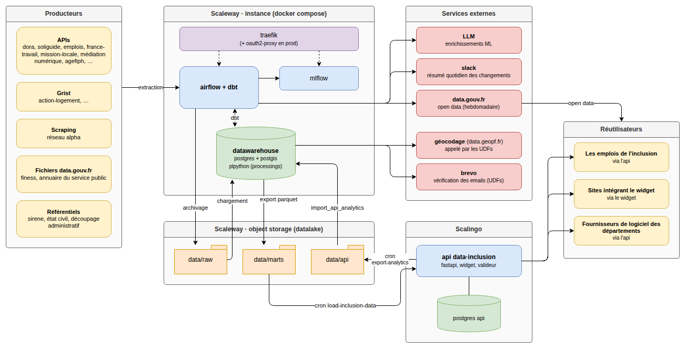
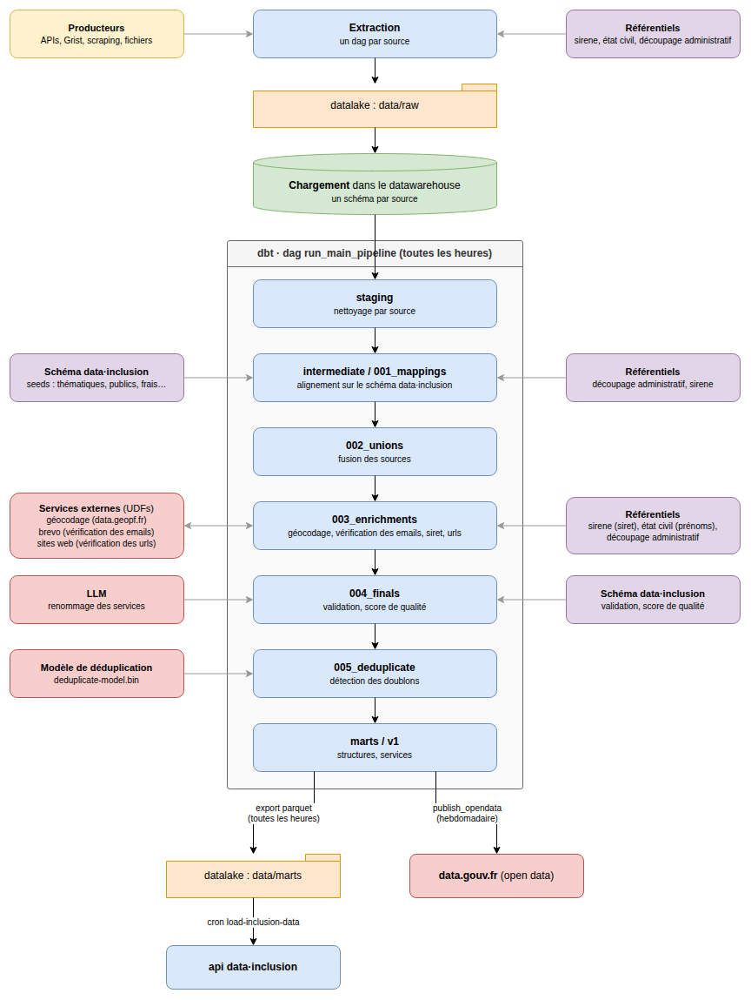

# Architecture

Airflow orchestrates the main data pipeline.

1. Extract data from the producers and save it raw in the datalake.
2. Load the raw data into the datawarehouse.
3. Transform the data using dbt.
4. Export the final dataset to the datalake (and publish it to data.gouv).

The api then picks up the dataset and serves it.

## Overview

## Data pipeline

